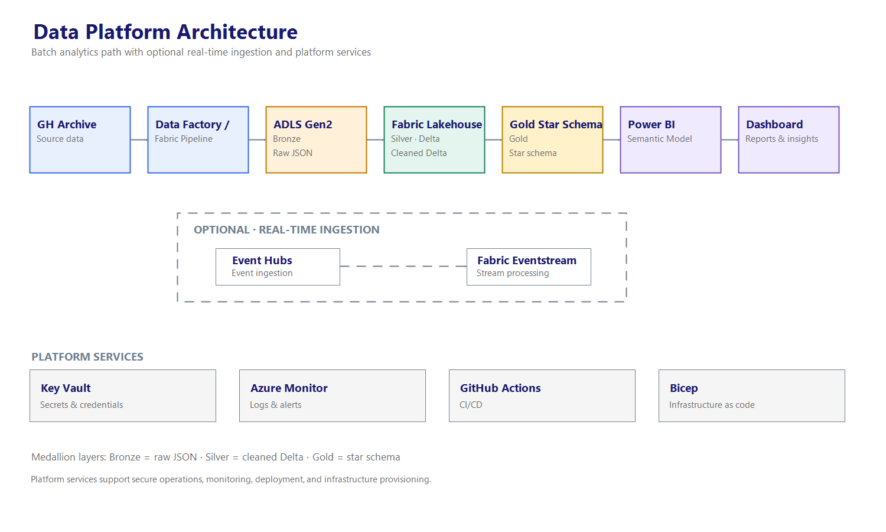

# OSS Pulse 

> An end-to-end data lakehouse on **Azure + Microsoft Fabric** that ingests,
> models, and visualizes public GitHub activity from [GH Archive](https://www.gharchive.org).



## Project Goals
- Build a medallion architecture (Bronze → Silver → Gold) on ADLS Gen2 and Fabric
- Practice incremental, idempotent ingestion with Azure Data Factory / Fabric Pipelines
- Model a star schema and serve it through a Power BI semantic model
- Apply production practices: IaC, CI/CD, data quality, monitoring, secrets management

## Tech Stack
| Layer | Tools |
|---|---|
| Source | GH Archive (hourly JSON) |
| Orchestration | Azure Data Factory / Fabric Data Pipelines |
| Storage | ADLS Gen2, Fabric Lakehouse (Delta Lake) |
| Transform | PySpark (Fabric notebooks) |
| Serving | Fabric Warehouse, Power BI (Direct Lake) |
| DevOps | Bicep, GitHub Actions, Key Vault, Azure Monitor |

## Roadmap
- [ ] Phase 1: Foundations (Days 1-5)
- [ ] Phase 2: Ingestion / Bronze (Days 6-11)
- [ ] Phase 3: Transform / Silver (Days 12-18)
- [ ] Phase 4: Model / Gold + Power BI (Days 19-25)
- [ ] Phase 5: Production polish (Days 26-30)

## Repo Structure
```
infra/        Infrastructure as Code (Bicep)
ingestion/    Python scripts + pipeline definitions
notebooks/    PySpark notebooks (bronze → silver → gold)
sql/          Warehouse DDL and views
powerbi/      Power BI project + screenshots
tests/        Unit tests
docs/         Architecture, ADRs, data dictionary
```

## Getting Started
_Coming soon, setup instructions will be added as the project progresses._

## Results
_Dashboard screenshots and metrics coming in Phase 4._

## Learning Log
See [`docs/learning-log.md`](docs/learning-log.md).